# Bmax - Blender 5.2.3 LTS

Bmax is a custom Blender **5.2.3 LTS** build focused on clearer armature visualization, a more convenient rigging interface, UV inspection tools, mesh cleanup workflows, Sculpt topology and mask tools, and Multires color painting in Sculpt Mode. Bone evaluation, constraints, and animation mathematics retain Blender's existing behavior.

## Download for Windows

[**Download Bmax for Windows from Gumroad**](https://maxpuliero.gumroad.com/l/bmax)

Sorry I can't include the compiled Windows build directly in this GitHub repository: the package is too large. Please download it from Gumroad using the link above. The full Bmax source code is available here.

For contributors and AI agents, see [the repository instructions](AGENTS.md) and [the Windows build guide](doc/bmax/BUILD_WINDOWS.md).

## Bug reports

Use **Help > Report a Bmax Bug** to open a pre-filled report in the [Bmax GitHub tracker](https://github.com/MaxPuliero/Bmax/issues). The system-information launcher used when Bmax cannot start opens the same tracker. Include whether the issue also occurs in official Blender and which version was tested; Bmax reports are investigated here first.

## Features

See the [complete feature inventory](doc/bmax/FEATURES.md) for implemented additions and dated updates through October 30, 2026, their source commits, and removed items.

### Edit selected items by default

With multiple items selected, editing a compatible property affects the selection automatically. Hold **Alt** to edit only the active item. Typing or pasting a number assigns the same value; dragging retains Blender's existing per-item delta behavior.

- **Modifiers:** compatible parameters and commands such as Add, Remove, Apply, Duplicate and supported stack movement use the selection by default. Adding a modifier asset follows the same rule. Parameter editing requires existing modifiers with matching names and compatible types.
- **Materials:** New creates one shared material for the selected editable objects. Choosing an existing material, unlinking, and adding/removing slots also affect the selection. Assignment uses the source slot index and activates that slot on destination objects, preserving other slots. Property editing targets each object's active material, including **Viewport Display**, **Line Art**, **Settings**, and colors. Color-picker cancellation and undo/redo preserve distinct original values.
- **Mesh Data > Geometry Data:** Add and Clear are available for **Sculpt Mask**, **Sculpt Face Sets**, **Skin Data**, and **Custom Normals**. Add preserves existing data; Clear skips missing data. Object and mesh Edit Mode are supported. Sculpt Mask keeps its existing restriction outside Sculpt Mode; the other commands retain their previous Sculpt Mode availability.

Shared meshes and materials are processed once and remain shared, including when using Alt. Non-editable or incompatible targets are skipped. Shader node graphs and material face-assignment operations are outside this feature; see the [inventory and validation scope](doc/bmax/FEATURES.md#default-multi-selection-property-editing-2026-10-28).

The implementation is included in source commit [`d46c5d5ecdbe`](https://github.com/MaxPuliero/Bmax/commit/d46c5d5ecdbeb3984b5f811c486c3318c8ea100e) on `main`. The local Windows runtime is rebuilt and verified, and the user confirmed the feature. Desktop copies and the public Windows download have not been updated.

### Bmax interface languages

Bmax-specific labels, menus, tooltips and operator messages are localized in **Japanese, French, Spanish, Simplified Chinese, German, Russian, Portuguese (Portugal and Brazil), and Italian**. Choose the language in Preferences > Interface and enable translation for Interface, Tooltips and Reports as desired. Standard Blender controls retain their existing upstream translations.

The local catalogs are installed and verified across 159 context/message keys per catalog. See [localization coverage and validation](doc/bmax/localization.md). The implementation is included in source commit [`1d0507ec174c`](https://github.com/MaxPuliero/Bmax/commit/1d0507ec174c14d8814a9ad5cde9e7b66aae9a23) on `main`. The local Windows runtime is updated; Desktop copies and the public download have not been updated.

### Select through opaque meshes

In mesh Edit Mode, enable **Select > Select Through**, or use the selection button beside X-Ray in the viewport header. This **single toggle** works in Vertex, Edge and Face modes, including mixed selection modes, for click, Box, Lasso and Circle selection in **Solid, Material Preview and Rendered** shading. It is **off by default**, saved per viewport, and leaves shading and transparency unchanged. Hidden geometry and existing projection/clipping filters still restrict selection. The shared-toggle extension is built and verified with 474 checks per backend on OpenGL and Vulkan, including EEVEE and Cycles Rendered views. The extension is included in source commit [`1d0507ec174c`](https://github.com/MaxPuliero/Bmax/commit/1d0507ec174c14d8814a9ad5cde9e7b66aae9a23) on `main`.

**Knife (K)** starts with **Cut Through enabled in Wireframe** and its usual front-surface behavior in other shading modes. Press **C** during Knife to toggle Cut Through. Explicit keymap, tool or Python choices take priority; Shift+K keeps its existing selected-geometry behavior. The local Windows runtime is rebuilt and verified with 68 interactive checks on each backend, OpenGL and Vulkan, plus old-file defaults and saved-option reload checks. The original vertex-only selection and Knife defaults are included in source commit [`ec3e80c36fac`](https://github.com/MaxPuliero/Bmax/commit/ec3e80c36fac9033e6dc35851d72adb700b64cd1) on `main`; the user confirmed the feature. Desktop copies and public packages have not been updated.

### Blender 5.2.3 integration

The 5.2.3 corrective-release code is included in [`776763085e8a`](https://github.com/MaxPuliero/Bmax/commit/776763085e8a3cdc2b17eae2680d6f22841847ac) on `main`, preserving the Bmax changes. It includes fixes for Multires masks when subdividing in Object Mode, bone picking, UV edge-ring selection, texture painting and image retention, plus stricter validation when opening damaged `.blend` files. Voxel Remesh optimizations, By Loose Parts, the default-on Fix Poles control and Decimate caching retain their implementations. See the [integration audit](doc/bmax/blender_5_2_3_sync.md) for compatibility checks, build status and scope. The local runtime is fully rebuilt and verified, and the user has confirmed that the updated build works in their workflow. Desktop copies and the public download are separate.

### Isolate with scene lighting and camera references

**Local View (Isolate)** keeps scene lights available to **Material Preview** and **Rendered** shading while hiding the viewport widgets of lights excluded from the isolation. The shading mode's **Scene Lights** setting still controls whether scene lights are used. Lights explicitly included in Local View remain visible and editable; hidden lights and viewport filters retain their effect.

Enable **Camera Data Properties > Background Images > Keep in Local View** to retain the active viewport camera and its reference images during isolation. The setting is saved per camera and defaults off. When enabled, entering Local View from camera view also preserves that view with the standard Frame Selected option. Other cameras remain subject to isolation; ordinary visibility filters still apply.

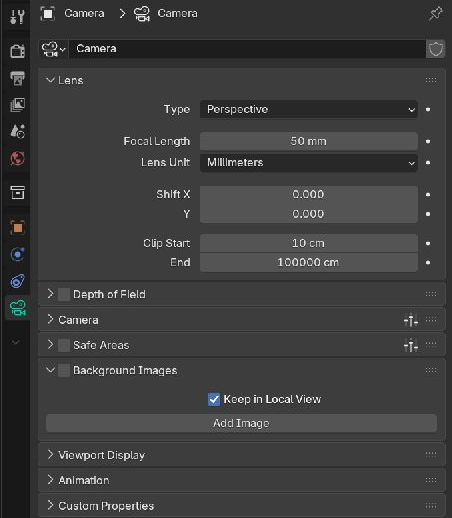

The implementation is included in source commit [`cdbaf6fefc0c`](https://github.com/MaxPuliero/Bmax/commit/cdbaf6fefc0c749cc268662e3d9d5ebbb36b3d95) on `main`. The local Windows runtime is rebuilt and verified on OpenGL/Vulkan, including EEVEE and a Cycles viewport check, and the user confirmed that both changes work. See the [feature inventory](doc/bmax/FEATURES.md) for validation scope. Desktop copies and the public Windows download have not been updated.

### Faster Voxel Remesh on closed meshes

Bmax checks for open edges before preparing the mesh for **Voxel Remesh (Ctrl+R)**. Already closed meshes skip the full BMesh hole search. Open meshes keep the existing automatic hole filling. Input and output transfers to OpenVDB also use fewer intermediate buffers. **Fix Poles is available in the Sculpt Remesh popover and Mesh Data > Remesh, enabled by default and saved per mesh**. Disable it manually to skip pole cleanup and its smoothing; enabled cleanup remains complete, including adaptive output. Existing files open with cleanup enabled unless explicitly disabled with this control.

Measured synchronous Sculpt operator times, with **Fix Poles enabled** in both builds:

| Fixture | Input triangles | Output faces | Before | After | Speedup |
| --- | ---: | ---: | ---: | ---: | ---: |
| Closed mesh, no projection | 1,310,720 | 40,927 | 968 ms | **217 ms** | **4.46×** |
| Closed mesh, preserved attributes | 327,680 | 114,431 | 698 ms | **558 ms** | **1.25×** |
| Closed mesh, Face Sets only | 327,680 | 114,431 | 636 ms | **515 ms** | **1.23×** |
| Open surface, filled and faired | 68,180 | 24,951 | 211 ms | **194 ms** | **1.08×** |
| Eight independent parts | 163,840 | 213,184 | 839 ms | **745 ms** | **1.13×** |
| Fine output, preserved attributes | 20,480 | 256,649 | 996 ms | 992 ms | ~1.00× |

Medians use one warm-up and five fresh-input samples on an i7-14700KF with 64 GiB RAM, with profiling off. They include geometry Undo and spatial organization, exclude interactive redraw, and are not universal speedup guarantees. The fine-output case is effectively unchanged because Fix Poles dominates. The first fixture's process peak working set fell from approximately 1,661 to 1,224 MiB, including setup and Undo. These results measure the optimized pipeline with cleanup enabled; they do not measure the optional speedup from disabling it.

The implementation is included in source commit [`83c95f81fd69`](https://github.com/MaxPuliero/Bmax/commit/83c95f81fd6990e1aebd003e7db2347742b91252) on `main`. The installed runtime is updated; Desktop copies and the public download are separate. See [implementation, stage profiling, validation and benchmark limits](doc/bmax/voxel_remesh_performance.md).

### Faster Decimate with Cache Result

**Cache Result**, enabled by default, keeps Decimate's last result in memory so adding or adjusting later modifiers can reuse it. Decimate recalculates when its settings or incoming mesh change, including coordinates, topology, UVs, colors, attributes, and vertex weights. Applying Decimate can also reuse the result when the application input matches.

The checkbox appears above **Face Count** in Collapse, Un-Subdivide, and Planar modes. Turn it off to release the cached meshes on the next evaluation and return to normal uncached calculation. The choice is saved per modifier; older files also default to enabled. Caching trades additional RAM for faster repeated evaluations; it does not eliminate the first calculation or the cost of modifiers before Decimate.

On a **327,680-triangle** fixture:

| Operation | Previous build | With Cache Result |
| --- | ---: | ---: |
| Change a later modifier | 1,294 ms | **0.25 ms** |
| Apply Decimate | 1,328 ms | **2.8 ms** |

These synchronous background measurements exclude interactive undo and drawing; the downstream result is a median, while Apply is one observation. Validation passed 69 initial cases and 34 checkbox follow-up checks, covering geometry and normals, invalidation, old-file defaults, save/reload, and undo/redo. See [cache behavior, memory cost, benchmark method, and limitations](doc/bmax/decimate_cache.md).

The implementation is included in source commit [`bb4bbad2a787`](https://github.com/MaxPuliero/Bmax/commit/bb4bbad2a787c5b424c461bc6d45c6540827b89c) on `main`. The local Windows runtime is rebuilt and verified, and the user confirmed a noticeable speedup. Desktop packages and the public Windows download have not been updated.

### Sculpt remeshing, Face Set cuts, and Bevel Mask

The Sculpt tools include:

- **Voxel Remesh (Ctrl+R)** runs **simple Fill Holes when needed → Remesh → optional Fix Poles (default on) → optional Fair Position**, with one undo step. Enable **Fair Position** in the Remesh popover to smooth only the new cap interiors after remeshing. **By Loose Parts** voxelizes connected components independently and keeps them disconnected inside the same object. Fair Position and By Loose Parts are saved per mesh and initially off.
- **Sculpt > Fill Holes** fills openings independently, creating a separate Face Set for each new patch by default.
- **Sculpt > Split** disconnects geometry while keeping one object: **By Face Sets**, **By Material**, **Masked**, **Visible**, **Faces by Edges**, and **Faces & Edges by Vertices**. Masks replace Edit Mode selection for the edge/vertex variants; without a mask, they use the visible surface. **Face Sets > Split by Face Sets** is a direct shortcut. Fill Holes and Split stay in Sculpt Mode and support one-step undo/redo.
- **Box, Lasso, Polyline, and Line Face Set** tools have **Cut Geometry** enabled by default. They insert edges along the gesture before assigning the Face Set. Turn it off to use the previous polygon-assignment behavior.
- **Mask > Bevel Mask**, directly below Smooth Mask, widens the mask transition using a surface-distance **Radius** and Blender falloff profiles such as **Sharp**, **Sharper**, **Smooth**, and **Custom**. Adjust them in **F9**. Custom uses an independent curve saved with the scene. Mesh, Multires, and Dynamic Topology masks are supported.

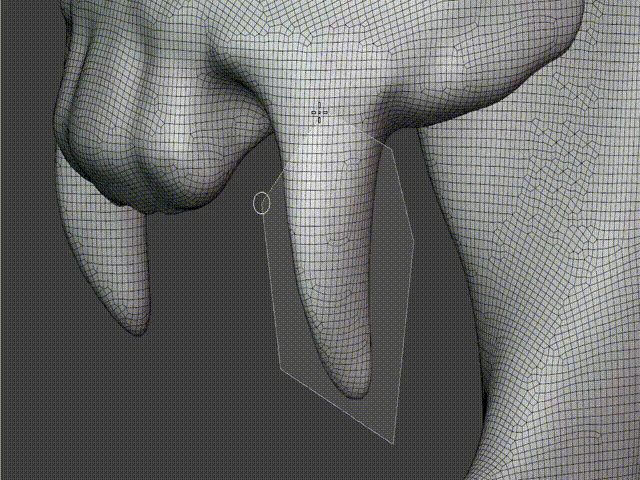

Fill Holes, Split, and Face Set topology cutting require a base mesh without Multires or Dynamic Topology; Split also requires no shape keys. See [behavior, validation, and limitations](doc/bmax/sculpt_voxel_masks.md).

The implementation is included in source commit [`b98ad0b25666`](https://github.com/MaxPuliero/Bmax/commit/b98ad0b256662a12363208849e55614de64905be) on `main`. The local Windows runtime is rebuilt and verified on OpenGL/Vulkan, including undo/redo, mask save/reload, and split/remesh integration. The separately copied Desktop packages and public Windows download have not been updated.

### Outliner collection selection highlights

Selecting an object also highlights its containing collections and all parent collections in the Outliner. The highlight remains visible when a collection is collapsed, making it easier to locate selected objects inside nested collections.

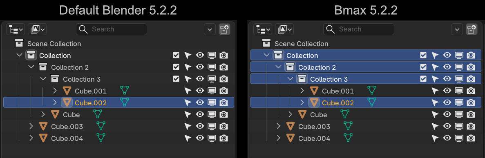

Collections containing the active selected object use the active-row highlight; other selected branches use the normal selection highlight. **Scene Collection** keeps its existing appearance. The hierarchy highlight updates with selection changes and preserves normal object and collection selection operations. The active object's name also remains brighter after deselection, using a near-white tone with the default theme, so it is easier to identify while other objects keep their normal text colors.

The local Windows runtime is rebuilt and verified on OpenGL and Vulkan. The implementation is included in source commit `d86a7a944cdf` on `main`; Desktop copies and the public Windows download have not been updated.

### Occluded selection outline theme

Change the color and transparency of object selection outlines hidden behind scene geometry in **Preferences > Themes > 3D Viewport > Occluded Selection Outline**, directly below **Object Selected**.

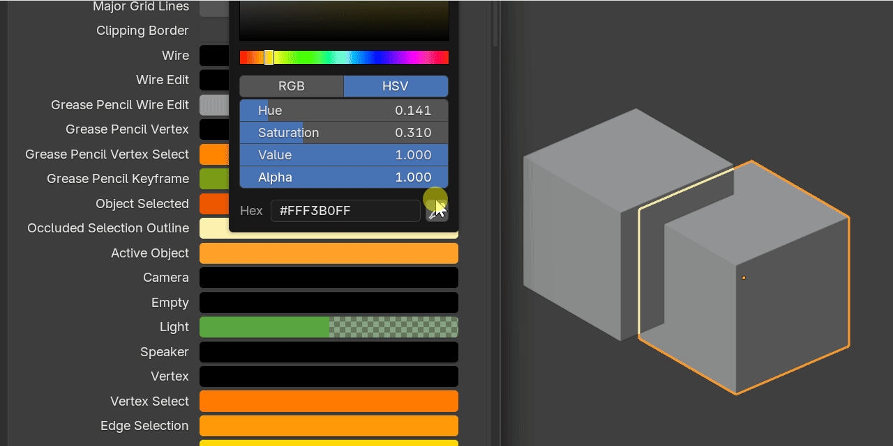

Use **Alpha** in the color picker to adjust opacity: **0** hides the occluded outline and **1** makes it fully opaque. The default is orange with approximately **35% opacity**. Visible portions retain their selected, active, or transform colors. X-Ray keeps its existing appearance and ignores this setting.

The theme controls are included in source commit `ad308b73519a` on `main`. The October 20 local update removes the projection-dependent outline depth bias and compares camera-space distances with a relative and depth-precision tolerance. It reuses the existing buffers and geometry passes; finite depth-buffer precision still limits nearly coincident surfaces at extreme clipping ranges. The updated local Windows runtime is rebuilt and checked on OpenGL and Vulkan; the depth-comparison implementation is included in source commit `1f04cb0020e9` on `main`. Desktop copies and the public Windows download have not been updated. An additional local correction preserves signed view depth for orthographic views; the earlier absolute-distance comparison could incorrectly reveal hidden outlines when geometry crossed view Z = 0. The corrected runtime was checked against the supplied body/hood scene on OpenGL and Vulkan. The orthographic correction is included in source commit `42dbb0dd6bf2` on `main`. See the [validation and limitations](doc/bmax/FEATURES.md#outline-occlusion-depth-comparison-local-update-2026-10-20).

### Hair Curves guide theme

**Preferences > Themes > 3D Viewport > Hair Curves** controls **Width**, **Selected**, and **Unselected** for individual Hair Curves guides in Edit and Sculpt Mode. Defaults are **4 physical pixels**, bright yellow selected guides, and dark yellow unselected guides. Soft selections blend the two colors. These controls are independent of NURBS and object-selection colors.

In Sculpt Mode, enable **Viewport Overlays > Sculpt > Cage** and adjust **Cage Opacity** to show the editable guides, including Hair Curves objects with Geometry Nodes modifiers. Generated strands remain part of the evaluated hair; the cage represents editable source guides. Hair radii, materials, rendering, and curve geometry are unchanged. Existing preferences receive the new defaults without resetting other theme settings. The local Windows runtime is updated and verified with OpenGL and Vulkan. The implementation is included in source commit `0fedd7e24fb9` on `main`; separately copied Desktop packages and the public download have not been updated.

### Multires color painting in Sculpt Mode

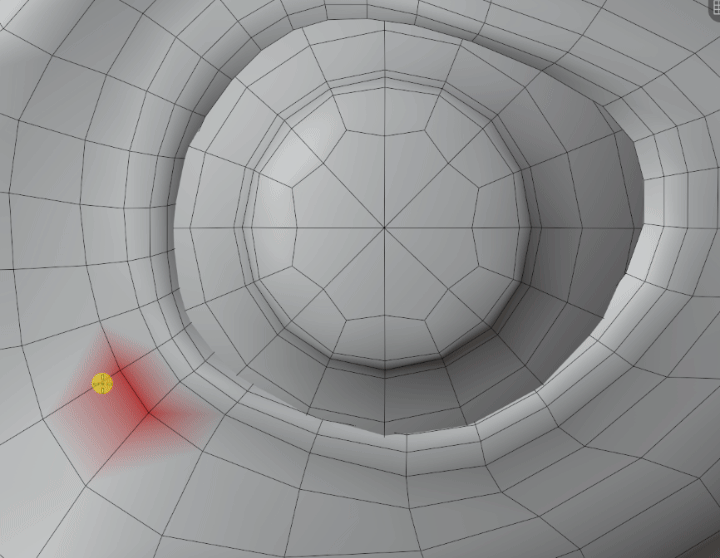

Paint, Blur, and Smear can edit color at the current Multires sculpt resolution. RGBA grids are saved with the active color attribute; changing levels retains the highest painted detail, and lower-level strokes update that detail. Undo/redo and saving/reopening preserve the grids. Applying Multires produces a regular color attribute on the evaluated mesh.

Brush updates and undo are restricted to the affected grids and their boundaries, and color storage is committed at stroke completion to keep painting responsive. This implementation supports Float and Byte attributes on Point and Face Corner domains. Color Filter and Mask by Color remain unavailable with Multires. The classic Vertex Paint mode retains its existing behavior. See [usage, storage, and validation notes](doc/bmax/multires_color.md). Publishing this source update does not publish a new Windows download.

### Object Mode Separate and fast Fill Holes

Added to the source on October 7, 2026, in commit `47896472`. **Object > Separate** and the Object context menu expose **By Loose Parts** and **By Material** using the existing C++ operator. **Fill Holes** now works in Object Mode under **Object > Clean Up** and in the context menu, as well as **Mesh > Clean Up** in Edit Mode.

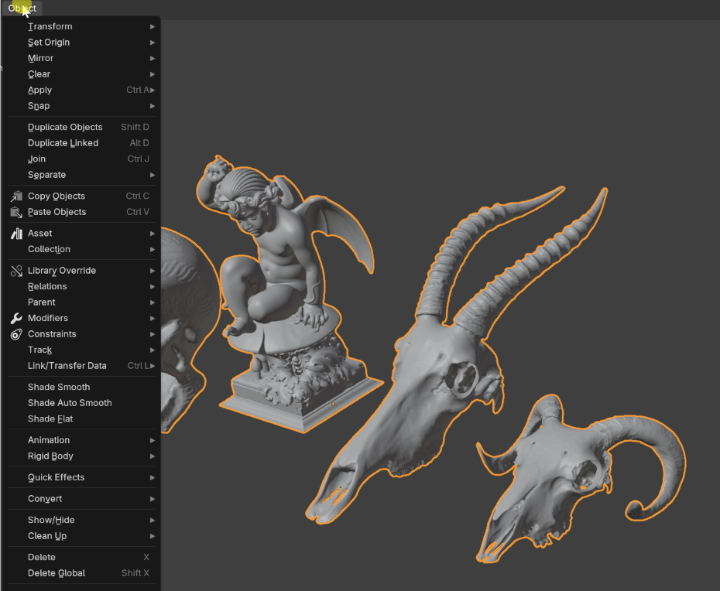

Fill Holes uses a native C++ fast path for simple boundary loops. Object Mode fills the selected mesh objects; Edit Mode respects selected edges. **Sides = 0** fills holes without a size limit and is the new default. Enable **New Face Sets** in **Adjust Last Operation (F9)** to give each newly filled patch a separate Sculpt Face Set while preserving existing IDs.

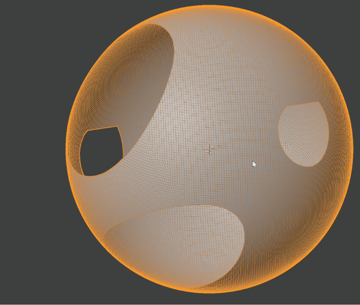

On the supplied 624,503-face scan, Object Mode Fill Holes with Face Sets took a median **0.337 s**, closing all 28 boundary loops. The Edit Mode operator took **0.203 s** with the mesh already in Edit Mode. These synchronous background timings exclude interactive undo and redraw. See [implementation and validation notes](doc/bmax/object_mesh_tools.md). The local runtime has been updated; the separately copied Desktop package and public Windows download have not.

### Mesh Data normal weighting

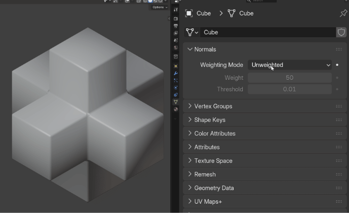

**Object Data Properties > Normals** offers **Unweighted** (the existing Blender automatic normals), **Face Area**, **Corner Angle**, and **Face Area & Angle**, with **Weight** and **Threshold** controls. Sharp edges and flat faces remain effective. Imported or manually edited custom normals take precedence; the Weighted Normal modifier can override the automatic result with its existing settings.

The setting is stored per mesh and does not bake automatic weights into custom normals. Official Blender can open the same `.blend` and uses its standard automatic shading when no custom normals or normal modifier is present. See [normal weighting notes](doc/bmax/mesh_normal_weighting.md) for compatibility and performance checks. The local runtime has been rebuilt and verified. The implementation is included in source commit `6f8c2738` on `main`; the separately copied Desktop packages and public Windows download have not been updated.

On the supplied scan, Face Area & Angle at Weight 50 took **6.84 ms** through Mesh Data versus **377.92 ms** with an active Weighted Normal modifier in Object Mode, and **34.00 ms** versus **417.49 ms** in Edit Mode. These medians measure geometry evaluation plus normal readback, excluding drawing and undo; unchanged cached reads are about 1 ms for both paths. See the notes above for methods and numerical differences.

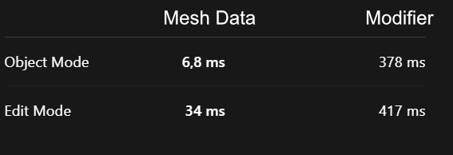

### Shared random colors for instances

Enable **Instances** in **Viewport Shading > Color** with **Random** selected for Object or Wireframe colors. Both modes share the checkbox, which defaults off.

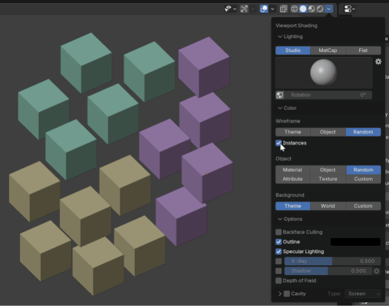

The **Object Info** shader node has an independent **Instances** checkbox affecting only its **Random** output in EEVEE and Cycles. Different nodes can use either behavior in the same material.

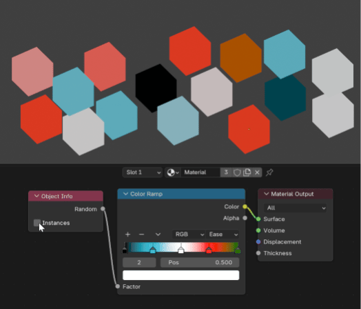

Alt+D linked duplicates, object/collection instances, and Geometry Nodes instances share a color/value by their geometry source, including generated and nested instances. **Realize Instances** ends this grouping. Generated prototype colors may change if their set or traversal order changes. See [controls, validation and timings](doc/bmax/instance_random.md).

The implementation is included in source commit `f68b422571e9` on `main`, and the local Windows runtime is updated. Separately copied Desktop packages and the public download have not been updated.

### Selected mesh openings

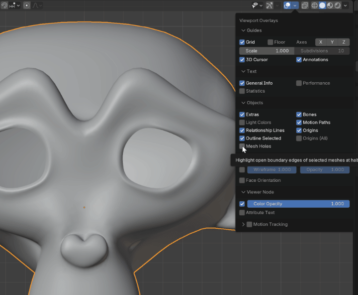

**3D Viewport > Overlays > Objects > Mesh Holes**, enabled by default, highlights open boundary edges of selected meshes in Object Mode. The line uses the selection color and half the theme's selection outline width, with a minimum of two physical pixels. Closed meshes and internal shared edges receive no extra lines. The option follows **Outline Selected**, the master Overlays toggle, X-Ray, and the object's In Front setting.

The boundary geometry is cached until the mesh changes and supports evaluated meshes and subdivision. See [the implementation and validation notes](doc/bmax/mesh_holes.md).

### Windows icon antialiasing and DPI sizes

Windows application and blend-file icons retain the Bmax logo with antialiased alpha edges. Small entries through 96 pixels now use 32-bit Windows bitmap payloads with alpha and a matching transparency mask; larger previews remain PNG. Sixteen sizes from 16 to 256 pixels include intermediate DPI sizes, avoiding rescaling a neighboring icon entry. See [icon implementation and validation](doc/bmax/windows_icons.md). This is included in the local runtime; separately copied Desktop packages and the public download require their own update.

### Align Master

In armature **Edit Mode**, select the bones to change and make the reference bone active (select it last). Use **Armature > Transform > Align Master**, or search for **Align Master** with F3. The command immediately aligns all three axes and restores the standard **Adjust Last Operation** panel at the bottom left, showing the master and independent **X / Y / Z** buttons. The panel stays available while zooming or rotating the viewport; F9 reopens its controls. Each new invocation starts with all axes enabled; changes in the redo controls recalculate from the original state. Turning all three axes off restores the original bones without alignment. Only enabled **Euler XYZ rotation components in armature space** are copied; unchecked components retain the target's original Euler rotation. All three axes copy the complete master orientation.

The tool keeps bone lengths and adjusts roll as needed. Connected descendants translate to remain joined, including the master if one of its connected ancestors changes; the master's orientation remains the reference. Hidden, locked, unselectable and zero-length targets are skipped. The operation affects selected bones in the active armature only, supports Undo/Redo and F9 adjustment, and leaves the existing Align Bones command available. This is an Edit Mode rest-bone tool, not a Pose Mode animation operation.

The local Windows runtime is built and verified on OpenGL and Vulkan. Implementation: [`1a7224cacda9`](https://github.com/MaxPuliero/Bmax/commit/1a7224cacda95638640cd83d729ae69d84420a63), included in `main`. Desktop packages and the public download are unchanged. See the [feature inventory](doc/bmax/FEATURES.md#align-master-2026-10-26) for validation scope.

### Absolute Octahedral Radius

Each bone has an **Octahedral Radius** control in **3D Viewport > N sidebar > Item**, available in Edit and Pose Mode. One absolute radius controls the octahedral body's half-width and both endpoint spheres, independently of rest-bone length. In Wire display, the Head and Tail spheres shown in Edit Mode use this same radius. The default for newly created bones is 0.02 Blender units (2 cm with standard metric units). In Pose Mode, evaluated pose scaling and shear remain visible, including nonuniform scaling.

In Octahedral display, the body now has a flat square base at the Head sphere boundary and tapers to the Tail sphere boundary. Head/Tail spheres retain their size, position, and selection behavior. Bendy Bones shown in Octahedral keep connected segment bodies with no intermediate spheres; only the two outer endpoints are trimmed. Bodies fully covered by overlapping endpoint spheres are omitted. The B-Bone box display type is unchanged. This body-shape update is included in source commit `2e4febbdb1df` and in the verified local runtime. Separately copied Desktop packages and the public Windows download require their own update.

Connected Octahedral bones trim their root against the preceding bone's actual tip sphere, so different radii do not leave a gap. The shared sphere keeps the parent's radius. Extruding with E or click-extrude inherits the source bone's Octahedral Radius, Axis Size and display type; the extrusion gesture still determines the new bone's length. The correction is included in [`f90af1103223`](https://github.com/MaxPuliero/Bmax/commit/f90af110322384598de0ff545780af5be75ac4d6) on `main` and in the verified local runtime. Desktop packages and the public download are unchanged.

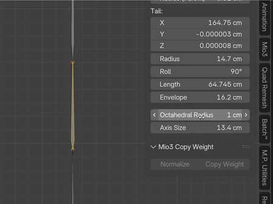

### Independent Axis Size

**Axis Size** appears directly below Octahedral Radius. It controls the display axes independently of bone radius and length. The default is **0.03 Blender units**, or **3 cm** with standard metric units. The object's scale still affects viewport display. Enabled bone axes always draw in front of scene geometry and other bones, even when the armature's In Front setting is off.

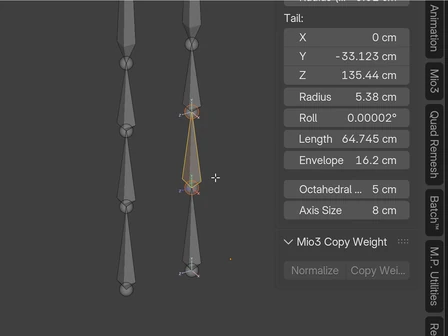

### Default new bone length

New armatures and **Add Bone** in Edit Mode start with a bone length of **20 cm**: `0.2` Blender units with standard metric units, adjusted for the scene's unit scale. Explicit operator lengths and radii are respected. Existing bones, duplicates, and extrusions keep their existing lengths and behavior; armature object scale still applies.

### New armature and bone display defaults

New armature objects use **Octahedral**, **In Front**, and object **Wire** display. Newly created bones default to Octahedral independently of the armature display type. **Add Bone** also enables In Front and Wire on the existing armature object. Existing bones retain their per-bone display settings; duplicates and extrusions retain their source settings.

Mesh Holes and its tooltip are translated into Japanese, Italian, French, and Spanish. This viewport polishing is included in source commit `5f6eba240126` and in the verified local runtime. Separately copied Desktop packages and the public Windows download require their own update.

### Default new bone rotation mode

New bones use **XYZ Euler** rotation by default, including new armatures and bones added in Edit Mode or through Python. Resetting Rotation Mode to its default also selects XYZ Euler. Existing bones keep their rotation modes; duplicates retain the source bone's mode.

### Active endpoint in Outliner range selection

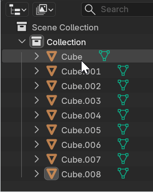

Shift-click activates the clicked endpoint after selecting an Outliner range. The selected range remains synchronized with the viewport; Ctrl+Shift can add the range to the existing selection. Subsequent Shift-clicks use the new active endpoint as their starting point. The local runtime in `D:\blender_build\octahedral_radius\bin` is updated and verified in nine GUI operator cases. Implementation commit: `87036d985cd3`, included in `main`. Separately copied Desktop packages and public Windows downloads have not been updated.

### Selection outlines for coincident elements

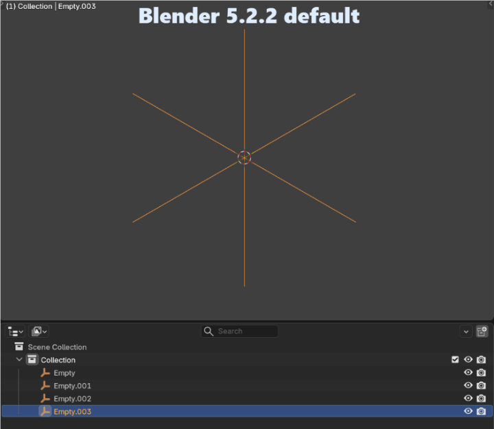

When armature elements coincide at the same depth, unselected elements are drawn first, selected elements next, and the selected active element last. This prevents a later unselected bone from replacing the selection outline and gives the active bone priority among coincident selected bones. The ordering applies to Pose and Edit Mode and selected armature objects. Existing depth tests, X-Ray/In Front behavior, and picking remain in place. Selected mesh objects also retain their outlines when coincident with unselected meshes. Empty shapes and image frames, legacy curves, lattices, and meshes made only of loose edges or points use the same selection priority in Object Mode. Their wires are grouped by selection across these overlay types, so creation order does not hide the selected color.

### Names and axes for selected bones

The armature's **Names** and **Axes** toggles display these overlays only for selected bones. In Edit Mode, selecting a head or tail also qualifies the bone. Existing master toggles still enable or disable each overlay.

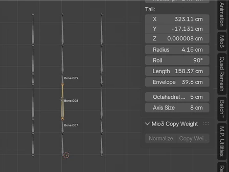

### Hide/unhide synchronization

Bone hide state transfers between Pose and Edit Mode when switching modes. Hidden bones are deselected during transfer. Bone collection visibility remains a separate visibility filter.

### Origin axes during transforms

With **Options > Affect Only > Origins** enabled, the origin axes default to **0.2 Blender units** (20 cm with standard metric units).

Uniform scaling remains visible while dragging. On confirmation, the axes return to their previous display lengths, retaining any differences between axes. Scaling an individual axis remains visible after confirmation: for example, scaling X by 2 changes its displayed length from 20 cm to 40 cm while Y and Z remain at 20 cm. Cancelling a transform restores the previous display. This adjustment is specific to the Affect Only Origins axes; the standard Object > Viewport Display > Axes display retains its existing behavior.

The uniform-scale compensation is stored per object in the `.blend` file.

### Modifier defaults

New **Weighted Normal** modifiers use **Face Area & Angle** with **Keep Sharp** enabled. New **Triangulate** modifiers have **Keep Normals** enabled. New **Displace** modifiers use **Strength = 0.1**. These defaults apply when adding modifiers; saved modifier settings remain unchanged.

### UV shell outlines and diagnostics

UV diagnostics inspect objects whose original type is Mesh. Curves, surfaces, and text evaluated as meshes retain their normal UV display without interpreting their original data as a mesh, preventing crashes when selecting or pasting them with UV overlays enabled. This correction is included in source commit `bcb82e789062` and in the verified local runtime. Desktop packages and the public download have not been updated.

In **UV Editor > Overlays > Geometry**, three controls help inspect visible UVs in both **Object Mode and Edit Mode**. In Object Mode they inspect the selected mesh objects:

- **Shell Outline** draws a white outline **2 physical pixels inward** along each UV shell boundary, including holes. Its width stays constant when zooming, and internal UV edges are excluded.
- **Overlap** highlights the intersecting area of overlapping UV faces in red, including partial intersections and overlaps between objects. **Opacity** controls the opacity from 0 to 1; its default is **0.5 (50%)**, and 1 gives solid red.
- **Flipped UVs** highlights UV faces with reversed orientation in magenta, with its own **Opacity** slider defaulting to **0.5 (50%)**.

**Faces** has a separate **Opacity** slider, also defaulting to **0.5 (50%)**. It controls the face fill independently of UV line opacity. All three fill opacity controls work in Object and Edit Mode.

When both diagnostics are enabled, red takes priority in overlapping areas. In Object Mode, UV lines are drawn after the face and diagnostic fills so Flipped and Overlap do not cover the lines. Object Mode lines use the chosen UV line opacity without the automatic quarter-strength fading of modifier/paint guides. White shell outlines appear above the diagnostics. The main Overlays toggle hides these UV diagnostics. Both modes use the same Geometry panel, diagnostic flags, fill opacities, UV line opacity, and face visibility settings. Changing a control in either mode is reflected when switching to the other. Shell Outline, Overlap, and Flipped follow **Modified Edges**: when enabled they inspect the evaluated modifier UVs, including repeated or inverted UVs; when disabled they inspect the original UV map. The original cage and evaluated surface are never counted together.

Modified Edges retains the full evaluated UV resolution; no pixel approximation or geometry simplification is used. On dense modifier results, diagnostics process more faces and GPU subdivision may also require CPU mesh evaluation. Disable Modified Edges to inspect the lighter original UVs. The evaluated diagnostic path is skipped when all three diagnostic overlays are off. No performance benchmark or speedup is claimed.

The Modified Edges implementation is included in source commit [`5b1bd4c7a742`](https://github.com/MaxPuliero/Bmax/commit/5b1bd4c7a742151fc546a4dfc0665e5fcac762eb) on `main`. The local Windows runtime is rebuilt and verified with 28 GUI cases on each backend, OpenGL and Vulkan. Desktop packages and the public Windows download have not been updated.

#### Partial UV overlap

The overlap color updates while UV shells move; only the intersecting area turns red. These demonstrations also show the inward shell outlines.

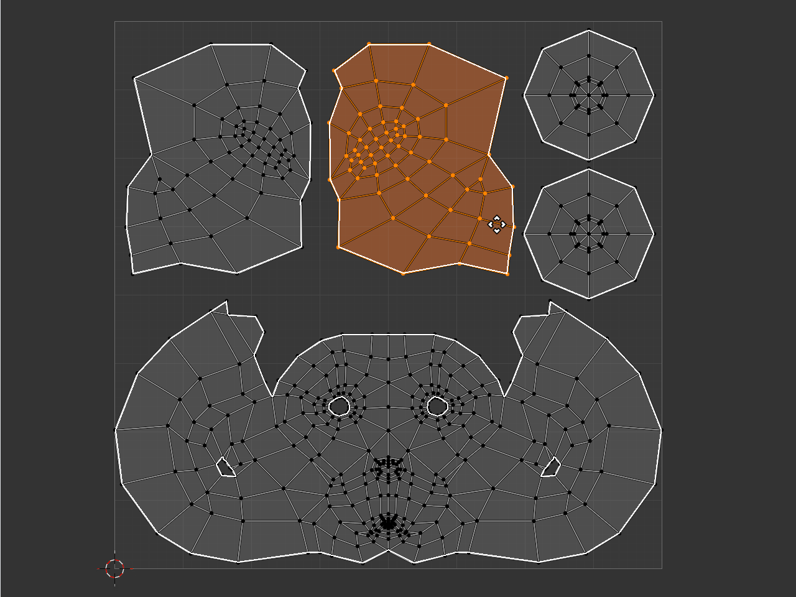

#### Flipped UVs

Mirroring a UV shell immediately marks its reversed orientation in magenta.

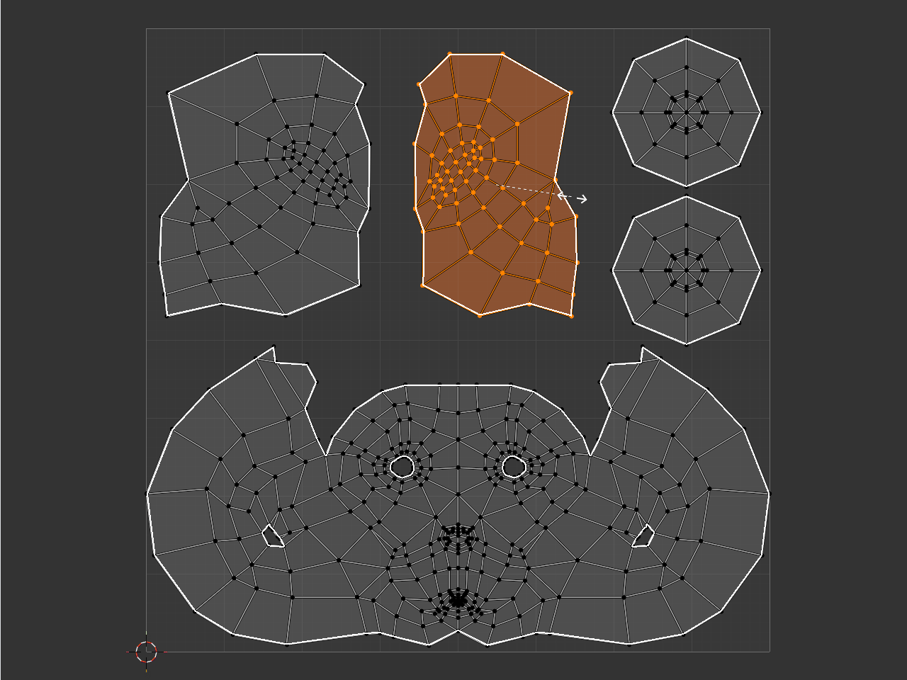

### UV background opacity and stable framing

**UV Editor > Overlays > Image > Opacity** controls the background image's opacity independently of the UVs. At 0 the image is transparent; at 1 it is fully visible. This setting remains effective when the main Overlays toggle is off.

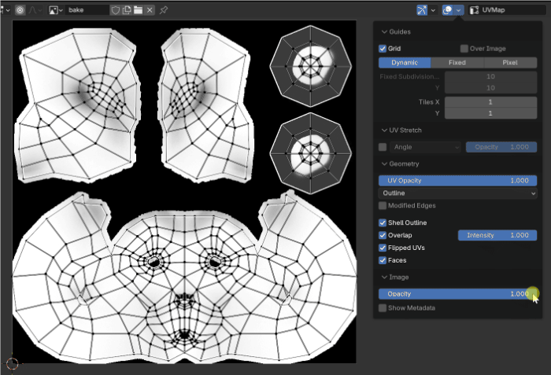

Adding, removing, or switching the background image preserves the UVs' size and position on screen, including switches between 512-pixel and 4K images or images with different aspect ratios. Automatic image changes from the active material also preserve the view. Pan and zoom continue to work after an image change.

### Branding and Windows executable

Bmax includes a custom splash logo and Windows icons, Bmax window titles and command-line version output, and a separate Bmax Windows application identity. The executable is named **blender.exe**. It uses the existing Blender 5.2 preferences and startup configuration.

## File compatibility

Bmax uses Blender's `.blend` format. Its custom Octahedral Radius, Axis Size, origin-axis uniform-scale compensation, UV diagnostic settings, background opacity, and UV view aspect are stored in Bmax files. Files lacking the UV diagnostic settings open with those flags disabled and missing fill opacities set to 0.5; missing background-image opacity defaults to 1. Saved opacity values are retained. Explicit zero values survive saving and reopening. Official Blender does not expose the Bmax-specific properties and may discard them when re-saving a file. Standard rigging and animation data continue to use Blender's existing structures.

Mesh Data normal weighting is saved per mesh; official Blender ignores the extra settings and uses its standard automatic normals, while preserving ordinary custom normals and modifiers. Re-saving there discards the Bmax weighting choice. Multires paint grids require Bmax: apply Multires in Bmax to transfer a finished painted mesh as a regular color attribute. See the [normal weighting](doc/bmax/mesh_normal_weighting.md) and [Multires color](doc/bmax/multires_color.md) notes for details.

## Build and source

This repository publishes a source snapshot based on Blender **v5.2.3**, upstream commit **e13b728c6880d3084d9d57c30031ed5df8b39dee**, plus the Bmax changes. It does not include Blender's complete upstream Git history. `main` is the stable development and build branch. The retired `codex/armature-ui` and `codex/bmax-publication` branches are preserved by the tags `archive/armature-ui-2026-10-05` and `archive/bmax-publication-2026-10-05`. New changes can use temporary feature branches before integration into `main`.

Use [Blender's Windows build instructions](https://developer.blender.org/docs/handbook/building_blender/windows/). Git LFS is required: `.lfsconfig` downloads inherited assets from Blender's public LFS server and routes LFS uploads to MaxPuliero/Bmax on GitHub. Bmax-owned artwork and the animated demonstrations are stored directly in this repository. Dependency submodules retain their upstream Blender URLs. Precompiled libraries and local build output are not committed.

The Windows Release build has compiled successfully using Visual Studio 2022 / MSVC v143. The current local build omits precompiled CUDA, HIP, and oneAPI kernels. This publication contains source code rather than a packaged Windows binary.

See [Building Bmax on Windows](doc/bmax/BUILD_WINDOWS.md) for the verified local paths, Release build and installation commands, and an inline startup check. On 2026-10-06, source commit `6a2340f5a1dd` on `main` compiled and installed successfully. The installed build passed Manifold Boolean, XYZ Euler and 50% UV fill default checks, plus Box/Lasso/Polyline/Line Trim on closed meshes without Multires in OpenGL and Vulkan. Runtime and standalone bug-report links were verified to target Bmax GitHub issues. Bmax development tests have been removed; inherited Blender tests remain, with test targets disabled in the local build. Temporary verification files and logs are kept outside the source repository and removed afterward.

Origin axes were checked in 19 viewport captures on both OpenGL and Vulkan, including old-file migration, 20 cm defaults, uniform scaling during the modal gesture and after confirmation, per-axis scaling, cancellation, negative uniform scaling, Undo/Redo, and save/reload in a new session. The object geometry retained its world-space position throughout the origin transforms.

Object Mode UV diagnostics were additionally checked in 15 cases on each backend, including holes, UV seams, hidden faces, partial overlap, flipped UVs, and the 2-pixel outline at two zoom levels. Ten captures per backend verified shared panel availability, repeated mode switches, settings and framing preservation, changes made in either mode, the main Overlays toggle, and original UV diagnostics with Array modifiers.

The UV changes were checked in the running editor on both OpenGL and Vulkan: 15 diagnostic cases, including the exact 2-pixel outline at two zoom levels, and 21 background/view cases covering 4K images, rectangular images, removal, automatic image changes, pan, zoom, opacity, and save/reload. Image switches produced no change in the measured UV screen coordinates. Old-file migration and persistence were also verified.

The armature demonstrations are animated WebP files resized to **35%** of their original dimensions (448 × 336), retaining frame timing and looping. The normal weighting, Fill Holes, Separate, Mesh Holes, selection priority, and Multires painting demonstrations are animated WebP files encoded losslessly, retaining their original 720-pixel width, height, total duration, frame timing, and looping; identical consecutive frames can be combined. The instance viewport, Object Info, and Outliner selection demonstrations use the original animated GIFs at their native dimensions, preserving frame timing and looping. The UV demonstrations use the original animated GIFs, preserving their frame timing, resolution, and looping. The overlap and flipped-UV GIFs are displayed at 448 pixels wide; the image-opacity GIF is displayed at its original 700-pixel width to keep the controls readable.

## License and attribution

Bmax is derived from Blender, developed by the Blender Foundation and its contributors. Blender is licensed under the **GNU General Public License, version 3**; see [COPYING](COPYING) and the existing source-file notices for applicable terms. Bundled third-party components retain their respective licenses.

This is an independent custom build. See the [original Blender README](doc/bmax/README_BLENDER_UPSTREAM.md) for upstream project links.
