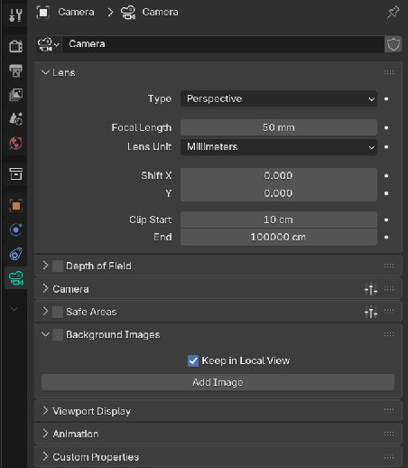
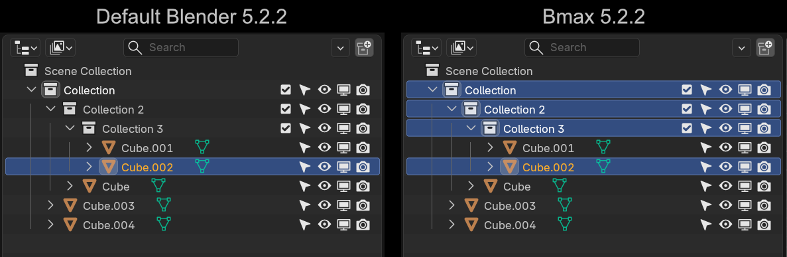
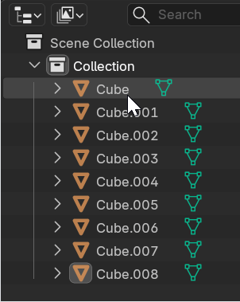
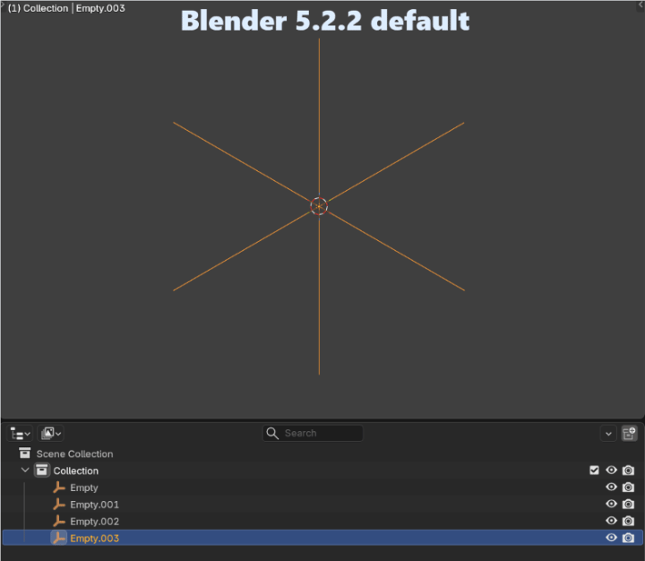
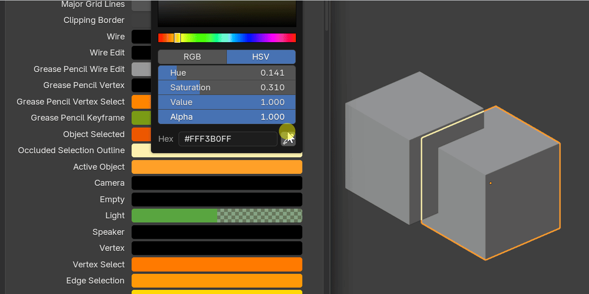
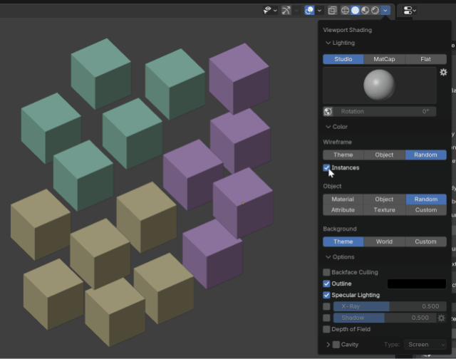
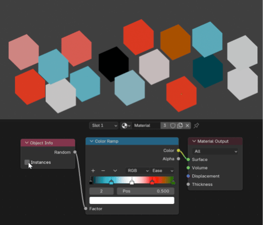

# Interface and viewport

[Artist guide](README.md)

## Organize Quick Favorites

Open **Preferences > Interface > Quick Favorites**, or choose **Manage Quick Favorites…** at the bottom of the **Q** menu.

Choose the editor and context, then use **Up/Down** to reorder commands and **−** to remove them. Different modes have their own lists. Top Bar and Properties entries appear as separate groups.

Add commands through their usual right-click menu. Save preferences, or use Auto-Save Preferences, to keep your changes.

## Continue your view across workspaces

Switching workspaces carries your last-used 3D view into the destination workspace: position, orbit, zoom and visibility follow you.

Shading and overlays stay specific to each workspace, so Layout can remain Solid while Shading stays in Material Preview. Other viewports and locked Quad View panels keep their own views. Workspaces pinned to different scenes are kept separate.

Local View and Local Collections follow the view too. Leaving Local View returns to the view you had before isolation.

## Keep useful references in Local View

Scene lights can continue lighting isolated objects in Material Preview and Rendered views without cluttering the view with their light widgets. Existing lighting and visibility settings still apply.

To keep camera references while isolating, enable **Camera Data Properties > Background Images > Keep in Local View** for the camera you use.

## Edit the selection together

Compatible edits to modifiers, materials and Mesh Data Geometry Data apply to the selected objects by default. This includes many modifier commands, material choices and slots, and adding or clearing supported geometry data.

Dragging a value keeps the existing differences where the control supports it; typing assigns the entered value. Alt does not restrict these edits to the active object.

When you want to affect one object, select only that object. Material node editing and face material assignment keep their usual workflows.

## Read selections more easily

Coincident objects and bones keep the selected element's highlight visible, with the selected active element taking priority.

In the Outliner, collections containing selected objects stay highlighted even when collapsed. The active object's name remains easier to identify after deselection.

**Shift-click** selects a range and makes the clicked endpoint active. **Ctrl+Shift-click** adds a range.

## Customize guide visibility

Open **Preferences > Themes > 3D Viewport > Hair Curves** for guide Width, Selected and Unselected colors. These affect editable guides, not strand thickness or generated hairs.

**Occluded Selection Outline** in the 3D Viewport theme controls the color and opacity of object outlines behind geometry.

## Color instances consistently

In **Viewport Shading > Random** color settings, enable **Instances** to group random colors by geometry source. The **Object Info** shader node has a separate Instances option for its Random output.

This helps related instances share a color. Realized instances behave as ordinary geometry. Colors may differ when opening the project in official Blender.

## Choose your language

Bmax-specific controls are translated into Japanese, French, Spanish, Simplified Chinese, German, Russian, Portuguese, Brazilian Portuguese and Italian.

Choose a language in **Preferences > Interface** and enable translation for Interface, Tooltips and Reports as desired.
