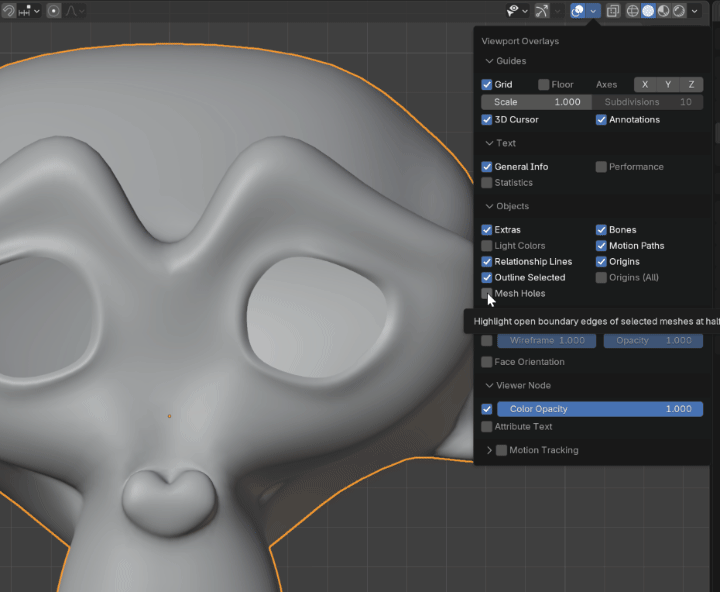
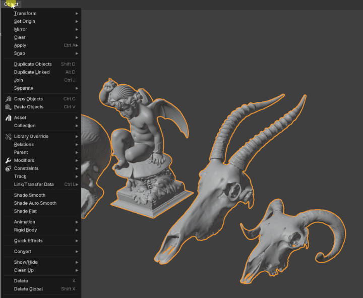
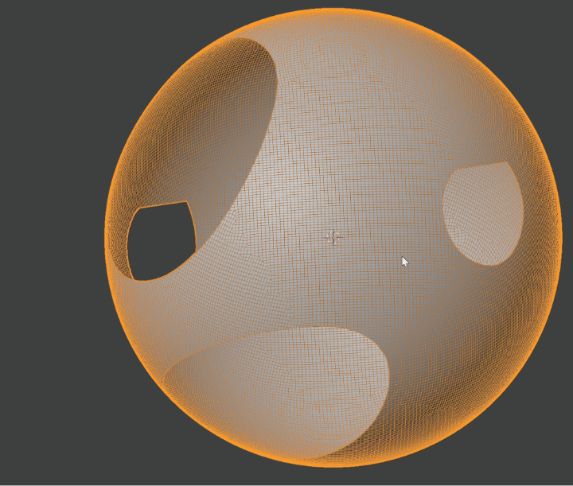
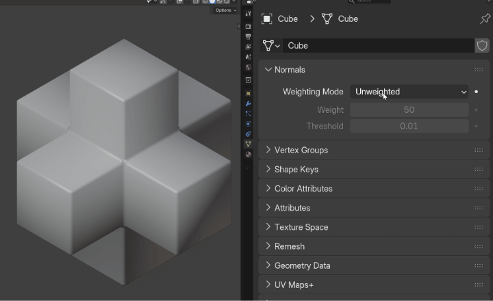
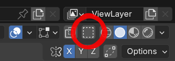

# Modeling and cleanup

[Artist guide](README.md) · [Sculpting](sculpt.md)

## Find open boundaries

Enable **3D Viewport > Overlays > Objects > Mesh Holes** to highlight open boundaries of selected meshes in Object Mode.

Use it to spot holes in scans or unfinished models before remeshing. Internal edges and loose wires are not highlighted as holes.

## Close holes and separate parts

Use **Object > Clean Up > Fill Holes**, or the Object context menu, to close boundaries without switching to Edit Mode. Edit Mode gives you control through selected edges.

Use **F9** to adjust **Sides**. Zero removes the side-count limit. Enable **New Face Sets** to give each new patch its own Sculpt Face Set.

**Object > Separate** and the Object context menu offer **By Loose Parts** and **By Material**.

## Adjust mesh shading

Open **Mesh Data Properties > Normals** and choose:

| Mode | Useful when… |
| --- | --- |
| Unweighted | You want standard automatic shading. |
| Face Area | Larger faces should have more influence. |
| Corner Angle | Corner angles should guide the shading. |
| Face Area & Angle | You want both influences combined. |

Adjust **Weight** and **Threshold** for the weighted modes. Sharp edges and flat faces still matter. Custom normals and normal modifiers take priority.

See [Saving and compatibility](compatibility.md) before sharing this shading with official Blender.

## Select through opaque surfaces

Enable **Select > Select Through**, or its header button beside X-Ray, in mesh Edit Mode.

It works in Vertex, Edge and Face selection, including mixed modes, with click, Box, Lasso and Circle selection. You can keep Solid, Material Preview or Rendered shading while selecting geometry behind the visible surface.

Hidden geometry stays excluded. The setting is saved per viewport.

## Cut and scale with fewer interruptions

**Knife** starts with Cut Through enabled in Wireframe. In other shading modes, it starts with front-surface cutting. Use **C** during the cut to toggle it.

Interactive **Scale (S)** in the 3D Viewport stops at zero. Press **N** during the operation to allow negative scaling. Typing a negative value also allows inversion. Each new scaling operation starts with the zero limit enabled.

## Keep Decimate responsive

The Decimate modifier's **Cache Result** option is enabled by default. It reuses an unchanged result when you adjust modifiers further down the stack. Changing the incoming mesh or Decimate settings refreshes the result.

Switch it off if you prefer not to retain the cached result in memory.

## Handy defaults

New Weighted Normal modifiers use **Face Area & Angle** with **Keep Sharp**. New Triangulate modifiers enable **Keep Normals**. New Displace modifiers start with **Strength 0.1**. Existing modifiers retain their settings.
