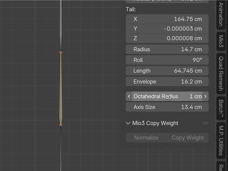
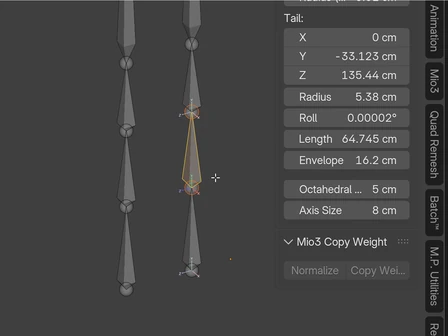
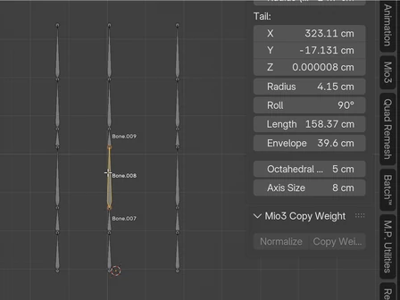

# Rigging

[Artist guide](README.md)

## Make bones readable at any length

Select bones in **Edit or Pose Mode**, then open **N sidebar > Item**.

- **Octahedral Radius** changes the width of the bone display and the size of its head/tail spheres independently of bone length.
- **Axis Size** changes the length of the displayed local axes independently of the bone's width and length.

Use a smaller radius for dense finger rigs and a larger one for controls you need to spot quickly. These are display controls; they do not change your rig's deformation or constraints.

Octahedral bodies meet their endpoint spheres cleanly, including connected joints. Segmented Bendy Bones appear connected in Octahedral display; the box-shaped B-Bone display remains available separately.

## Less clutter while posing

Enable **Names** or **Axes** in the armature's display settings. Bmax shows them for selected bones in Edit/Pose Mode. Enabled axes remain visible in front of geometry, helping you read bone orientation inside a character.

Names and axes are hidden in Object Mode and return when you enter Edit/Pose Mode. Hiding bones carries between Edit and Pose Mode.

## Align bones to a master

In armature Edit Mode, select the bones to align and make the reference bone active. Run **Align Master** from **F3**.

The selected bones align to the active bone. Open **Adjust Last Operation** or press **F9** to choose which X/Y/Z orientation components to match. Bone lengths are preserved; connected chains adjust to stay joined.

## More convenient starting defaults

New armatures and Add Bone start at **20 cm**, with scene units taken into account. New armatures use Octahedral display with **In Front** and **Wire** enabled. Add Bone also enables In Front/Wire on an existing armature.

New pose bones use **XYZ Euler** rotation. Existing bones retain their settings; duplication and extrusion preserve the source bone's display choices.
