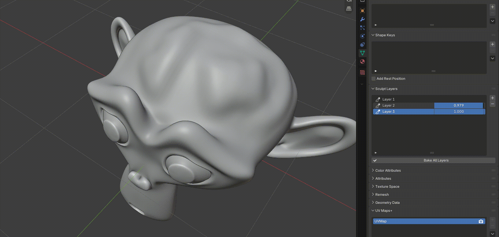
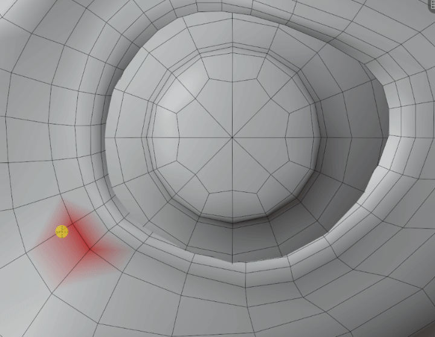
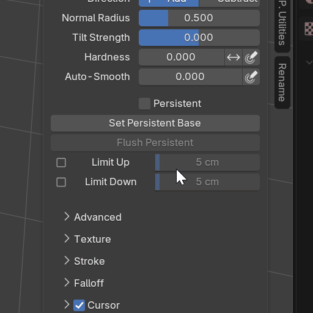
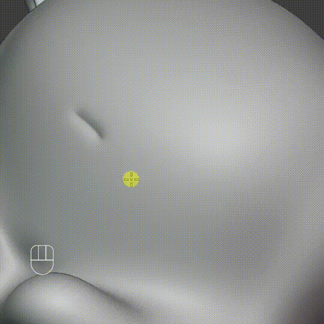
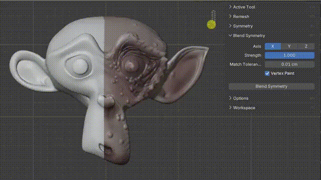
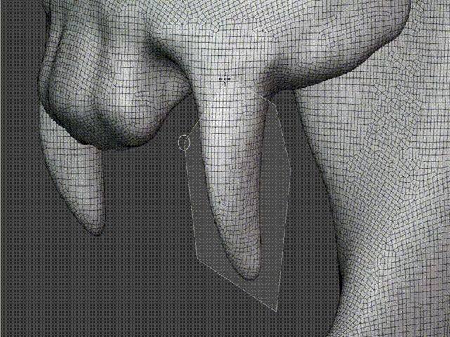

# Sculpting and painting

[Artist guide](README.md) · [Modeling and cleanup](modeling.md)

## Build a sculpt in layers

With a Multires mesh, open **Mesh Data Properties > Sculpt Layers**, below Shape Keys.

1. Sculpt your base on **Layer 1**.
2. Add another layer with **+** and make it active.
3. Sculpt details on that layer and adjust its **Influence**.
4. Add more layers to keep different sculpt passes adjustable.

Layer 1 is the permanent sculpt base: it has no Influence slider and cannot be removed. Additional layers can be removed with **−**, but cannot be reordered.

**Bake All Layers** merges the visible result into Layer 1 and removes the extra layers. Undo can restore the layer stack.

Layers work across Multires Sculpt levels, including level 0. They are saved with the project. Applying or removing Multires removes the editable layer stack.

This feature is experimental. Extra layers require a single-user mesh without shape keys, with Sculpt Base Mesh off and no other enabled modifiers. Ordinary mesh sculpting, Voxel Remesh and Dyntopo do not use this layer stack.

## Paint color on Multires

Use the **Paint**, **Blur** and **Smear** brushes in Sculpt Mode on a Multires mesh. Your painted detail is retained when changing subdivision levels and when saving the project. Sculpt masks protect the painted surface.

Use a **Color Attribute** node in your material to display the painted attribute. Applying Multires turns the painted result into a regular mesh color attribute; keep an editable copy if you want to continue working with Multires.

Classic Vertex Paint is a separate workflow. **Mask by Color** and Dyntopo color painting are not supported by this Multires painting feature.

## Adjust color across the sculpt

**Color Filter** supports Multires painting with Fill, Hue, Saturation, Value, Brightness, Contrast, Red, Green, Blue and Smooth.

Filters respect masks, hidden areas and automasking. Work at the Sculpt level you need; higher-resolution painted detail is retained. Undo restores the color without changing geometry.

Use **Shift+X** to sample the current painted color. **Sample Merged** samples the displayed result, including shading.

## Control how far a brush can move the surface

In the Sculpt brush settings, enable **Persistent** and use **Set Persistent Base** to capture your reference surface.

- **Limit Up** limits outward movement from that surface.
- **Limit Down** limits inward movement.
- The distance sliders control the allowed depth on each side.
- **Ctrl** temporarily swaps the two limits and their distances along with brush inversion.

Use **Update Persistent Base** when you want a new reference. Switching Persistent off suspends the limits while keeping the reference. **Flush Persistent** clears it without changing the sculpt.

The reference stays available when leaving and re-entering Sculpt Mode, but must be captured again after reopening the file. Brush Undo keeps the reference and its activation.

Cloth also respects the limits. Limit Down at zero can help the brush slide along the reference, but sharp edges and closely spaced surfaces are approximate; this is not self-collision.

## Strengthen the last stroke

Press **1** in Sculpt Mode, or choose **Sculpt > Repeat Last Stroke**, to add the last geometry stroke's deformation again. Repeated presses build up evenly: 2×, 3×, 4×.

You can rotate the view or change brushes first. Each repetition can be undone separately. The command repeats the resulting shape change; it does not run the brush or its masks again.

Draw a new stroke after changing topology or Multires level. Leaving Sculpt Mode clears the remembered stroke. Color and mask strokes are not repeated by this tool.

## Blend symmetry without discarding one side

Use **Sculpt > Symmetrize Blend**, or open **N > Tool > Blend Symmetry**.

Choose the axis and Strength. Matching unmasked areas blend toward their average. Mask the side you want to protect so it becomes the reference for the other side. Soft masks give a gentler blend.

**Vertex Paint** is on by default and blends the active color attribute too. Turn it off to change only the shape.

This works with fixed-topology meshes and Multires, including Sculpt Layers. Unmatched or ambiguous regions are skipped. Dyntopo is not supported.

## Remesh and prepare scans

In the Sculpt Remesh controls:

- **By Loose Parts** remeshes disconnected pieces separately, helping keep nearby parts from welding together.
- **Fix Poles** controls the cleanup pass after voxelization and is enabled by default.
- **Fair Position** smooths the interiors of newly filled hole patches after remeshing.

Voxel Remesh fills open boundaries before remeshing. Choose a small enough voxel size to preserve small parts; if a part disappears, the operation cancels so you can try a smaller size.

## Fill, split and cut without leaving Sculpt Mode

**Sculpt > Fill Holes** closes open surface boundaries. Use **F9** for Sides and New Face Sets. Zero Sides fills holes without a side-count limit.

**Sculpt > Split** disconnects geometry while keeping it in one object. Choose By Face Sets, By Material, Masked, Visible, Faces by Edges or Faces & Edges by Vertices. The edge/vertex options use the mask in place of an Edit Mode selection; an empty mask acts on the visible surface.

Fill Holes and Split do not support Multires or Dyntopo. Split also excludes meshes with shape keys.

Box/Lasso/Polyline/Line Face Set gestures have **Cut Geometry** on by default. They insert edges along the cut without deleting either side or creating separate objects. Switch Cut Geometry off to assign Face Sets only. Cutting requires a base mesh without Multires or Dyntopo.

## Shape mask borders

Choose **Bevel Mask**, directly below Smooth Mask, to shape a mask transition. Adjust Radius and the falloff profile, or use a Custom curve.

The tool works on ordinary meshes, Multires and Dyntopo.
