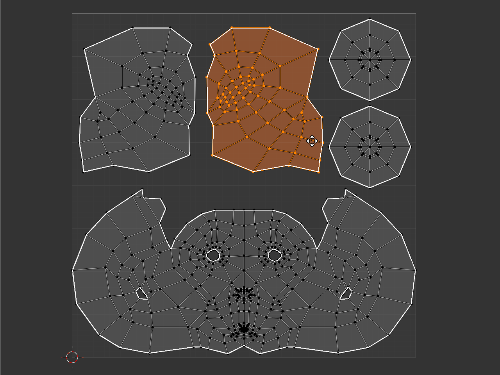
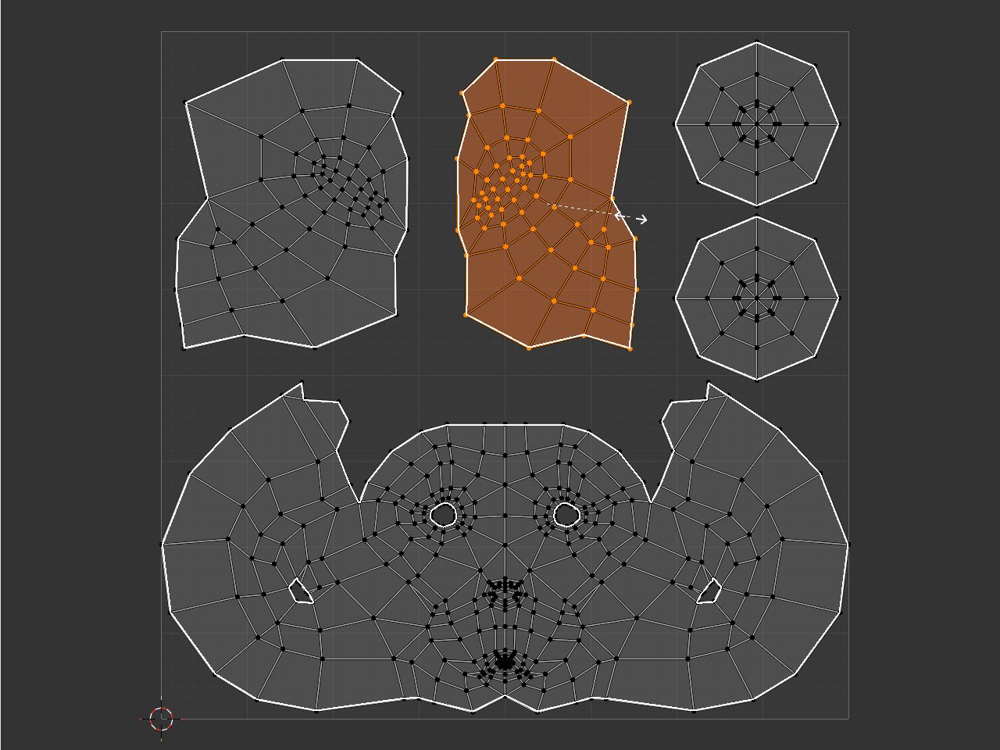
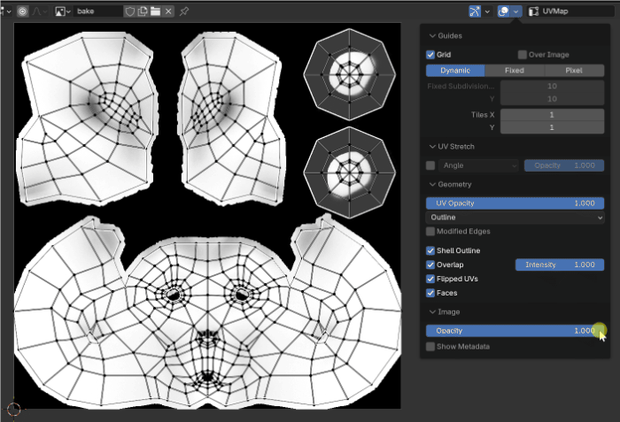

# UV editing

[Artist guide](README.md) · [What's new](whats-new.md)

## Inspect your UV layout

Open the **UV Editor > Overlays** popover and use the **Geometry** controls.

| Control | What it shows |
| --- | --- |
| Shell Outline | A thin white border inside each UV shell, including holes. Internal edges stay clear. |
| Overlap | Red fill where visible UV faces overlap, including partial overlaps and overlaps between objects. |
| Flipped UVs | Magenta fill on UV faces with reversed orientation. |
| Faces | The regular UV face fill. |

Adjust the separate fill opacities to keep the texture readable. Overlap red takes priority when a face is also flipped. The shell border keeps the same screen thickness as you zoom.

These controls also work in Object Mode on selected mesh objects, so you can inspect a layout without entering Edit Mode.

**Modified Edges** determines what you inspect: enable it to include modifier results, or disable it to see the original UV layout.

## Keep the texture out of the way

Use **Overlays > Image > Opacity** to fade the background image independently of UV lines and fills. Switching images preserves your UV framing, even when image sizes or proportions differ.

## Work with pins in any selection mode

Shell Outline stays below editable edges, vertices and pin markers. Selected and unselected vertices remain readable along shell borders.

Pinned vertices are visible in Edge and Face modes as well as Vertex mode. Use **UV > Pin**, **Unpin** or **Invert Pins** without changing selection mode:

- In Vertex mode, the command acts on selected UV vertices.
- In Edge mode, it acts on the endpoints of selected edges.
- In Face mode, it acts on the corners of selected faces.

You can also use these commands with synchronized mesh selection.

The selection visibility and pin improvements are planned for the next public Windows update.
